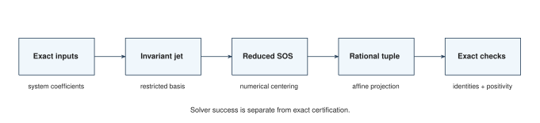
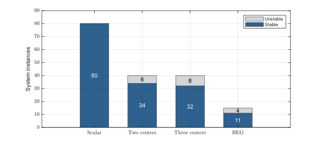
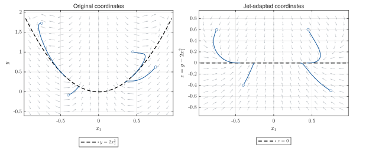

# Invariant-manifold SOS facial reduction — MATLAB reproduction

Compute invariant-manifold jets, construct Gram faces, reproduce the numerical
searches, and check rational Lyapunov certificates. **All executable code in
this repository is MATLAB. No Python installation is needed.**

Project repository: [invariant-manifold-SOS-FR](https://github.com/Birdycheat/invariant-manifold-SOS-FR).



Numerical feasibility, numerical centering, rational reconstruction and exact
verification are separate stages. A solver's success status is not a proof.

## Start here

Open the repository folder in MATLAB R2025b with Symbolic Math Toolbox, then run:

```matlab
report = run_reproduction("quick");
```

This checks representative certificates from each family, reconstructs a small
set of jets and exposing matrices, and reaggregates the numerical tables. It
does **not** start an SDP solver. MATLAB prints the output directory and a
per-file or per-section progress message. A successful run returns
`report.status == "passed"` and writes `run_report.json`.

The complete checks are:

```matlab
run_reproduction("symbolic");   % all jets, faces, classes and analytic bounds
run_reproduction("verify");     % all 376 retained SOS certificates
run_reproduction("tables");     % CSV and JSON versions of the numerical tables
run_reproduction("anchors");    % all 120 scalar anchored certificates
run_reproduction("witnesses");  % exact checks of already found invalidity points
run_reproduction("defects");    % exact transverse-defect criterion on 160 jet outputs
```

Full exact checks can be substantially slower than the quick check, especially
for the largest Gram matrices. They use rational arithmetic, not a tolerance
on floating-point eigenvalues.
Allow several hours for full sequential certificate verification on a desktop.
The quick check typically takes around one or two minutes in the tested
environment; timings depend on the machine and software.

Release validation is recorded in [results/matlab_validation.json](results/matlab_validation.json).
It distinguishes complete exact checks from one-instance numerical smoke runs.
Concise comments explain the main computational stages. The
[comment revision](results/comment_revision.json) records that executable lines
and Code Analyzer diagnostics remain unchanged.

### Requirements

| Operation | Required software |
|---|---|
| Tables and README figures | MATLAB |
| Jets, exact certificates, witnesses, anchors, defects and rounding | MATLAB + Symbolic Math Toolbox |
| New SOS optimizations | MATLAB + Symbolic Math Toolbox + YALMIP + MOSEK and its license |

The sources are tested with MATLAB R2025b. The numerical reference environment
used YALMIP 20250626 and MOSEK 11.1.10. The required subset of `frlib` is included
under its MIT license; YALMIP and MOSEK must be installed separately and on the
MATLAB path. Nothing is installed automatically.

```matlab
run_reproduction("environment")
```

This reports dependency availability. Finding the MOSEK binary does not by
itself check out an optimization license.

## Benchmarks at a glance

| Family | Central / transverse dimension | Main instances | Stable / unstable | Main exact certificates |
|---|---|---:|---:|---:|
| [Scalar polynomial](benchmarks/scalar/README.md) | 1 / 1 or 3 | 80 | 80 / 0 | 80 |
| [Two coupled centers, analytic field](benchmarks/coupled/README.md) | 2 / 1 or 2 | 40 | 34 / 6 | 34 |
| [Three centers, polynomial field](benchmarks/triple/README.md) | 3 / 1 or 2 | 40 | 32 / 8 | 32 |
| [BEG mean-field model](benchmarks/beg/README.md) | 1 / 1 | 15 parameter values | 11 / 4 | 11 surrogate + 11 true-field |



These are system-instance counts, not solver-output counts. The BEG surrogate
and true analytic field give two certificate problems for the same parameter.
The scalar archive also retains 40 order-three cases used in additional
checks; they are excluded from the main 80-instance table.

### 1. Scalar polynomial systems

The system is

$$
\dot x=g_0(x)+x\mathbf a^\top\mathbf y,\qquad
\dot{\mathbf y}=\Lambda\mathbf y+xB\mathbf y+x^2\mathbf v+x^3\mathbf w.
$$

The coefficients are rational, the transverse matrix is Hurwitz, and the
reduced field is exactly critical through the chosen order:
`f_reduced = -x^m + O(x^(m+1))`. The main groups use `m = 5, 7`, transverse
dimension `N = 1, 3`, and 20 seeds per group.

- **Domain:** the strip `|x| <= r`, with no bound on the transverse coordinates.
  The partially quadratic adaptation instead uses the ball
  `x^2 + ||y||^2 <= r^2` and zero decrease margin.
  The prescribed radius is half the largest radius found for the separate anchored family.
- **Searches:** free SOS degrees 2/4/6, the specified partially quadratic
  adaptation, partial facial reduction `d`/`dd`, and degree-four searches in
  `z = y - T_p h(x)`, with `p = (m-1)/2`, with and without reduction.
- **Result:** all 80 outputs of each floating jet variant are invalid. The
  transverse-defect criterion is checked exactly by `defects`: the first
  nonzero low-order defect has order one without reduction and order two with
  reduction. With reduction, 14 outputs also have explicit stored witnesses;
  the other 66 are refuted by the criterion despite the stored no-witness status.
  A subsequent reduced centering and exact reconstruction
  proves all 80 main instances. These are different numerical objects.
- **Radius convention:** each final proof uses the rational radius inside its
  certificate. Downward rounding to the `1e-4` grid reduces 76 radii and leaves
  four unchanged.

Run one numerical instance, including native rational reconstruction:

```matlab
run_reproduction("solve", Benchmark="scalar", N=1, M=5, Seeds=1, ...
    OutputDir=tempname);
```

Run the four main groups:

```matlab
run_reproduction("solve", Benchmark="scalar", N=[1 3], M=[5 7], ...
    Seeds=1:20, OutputDir=tempname);
```

Inputs are in `data/benchmark/` and `data/jet_inputs/`; exact SOS certificates
are in `data/certificates/` and `data/certificates_regions/`.

### 2. Two coupled centers

With `z = y - phi(x)`, a quadratic `phi = T_2 h`, the field is

$$
\dot x_i=(2-\cos(x_1-x_2))\widehat f_i(\mathbf x)
       +x_i\mathbf a_i^\top\mathbf z,
\qquad
\dot{\mathbf z}=(\Lambda+x_1B_1+x_2B_2)\mathbf z
       +e^{-\|\mathbf x\|^2}\widehat{\mathbf e}(\mathbf x).
$$

The forcing has degree four and the central polynomial has degree five.
The quadratic jet is generally not the entire invariant manifold: its
quartic correction contributes to the leading reduced field. The symbolic
checks reconstruct that correction from the field coefficients.

- **Domain:** `||x|| <= 1/2`, unbounded transverse directions.
- **Instances:** 20 seeds for each transverse dimension 1 and 2; independent
  exact leading-field tests give 34 stable and six unstable systems.
- **Programs:** degree-four original/adapted-coordinate searches and explicit
  jet faces, with four polynomial vertices for the analytic enclosure.
- **Result:** 34 exact certificates for the true field. No unstable instance
  is certified. The larger jet-four and composite-strip certificates are also
  retained and checked by the complete verification command.

```matlab
run_reproduction("solve", Benchmark="coupled", ...
    Instances="cp_ny1_s01.json", OutputDir=tempname);
```

Use `Enc=1` for the reference enclosure or `Enc=2` for the supplied higher-order
enclosure. The sources, candidate records and certificates are under
`data/coupled/`.

### 3. Three centers

This polynomial family uses three central coordinates, the same quadratic-jet
construction, degree-four forcing and a degree-five leading reduced field.
In the adapted coordinates `z = y - phi(x)`, its equations are

$$
\dot x_i=\widehat f_i(\mathbf x)+x_i\mathbf a_i^\top\mathbf z,\qquad
\dot{\mathbf z}=\left(\Lambda+\sum_{i=1}^3x_iB_i\right)\mathbf z
                    +\mathbf E(\mathbf x).
$$

The quartic graph correction is `eta4 = -Lambda^(-1)*E`. Consequently the
degree-five reduced field is
`f5_i = fhat_i + x_i*a_i^T*eta4`, rather than `fhat_i` alone.
The diagonal signs and bounds on the mixed terms permit an independent exact
weighted AM–GM classification.

- **Domain:** `||x|| <= 1/2`.
- **Instances:** 40, with transverse dimension 1 or 2; 32 stable and eight unstable.
- **Programs:** free SOS, partial `d`, jet-adapted degree-four searches, and
  layerwise reduction in original coordinates for the transverse-dimension-one
  subset. The latter is a separate representation, not an extra certificate cohort.
- **Result:** all 32 stable instances have exact adapted-coordinate certificates.
  The largest retained Gram block has size 95.

```matlab
run_reproduction("solve", Benchmark="triple", ...
    Instances="tr_ny1_s01.json", OutputDir=tempname);
```

Inputs, numerical candidates and certificates are under `data/triple/`.

### 4. BEG analytic model

The Blume–Emery–Griffiths mean-field heat-bath model uses `x = M`,
`y = Q - 1/a`, `rho0 = 1/(a-1)` and
`b = -a(a-3)/(2(a-1))`. With `D = 1 + rho0*exp(b*y)*cosh(a*x)`,

$$
\dot x=-x+\frac{\rho_0e^{by}\sinh(ax)}{D},\qquad
\dot y=-\frac1a-y+\frac{\rho_0e^{by}\cosh(ax)}{D}.
$$

The quadratic jet is `h2 = (a/3)*x^2`. The cubic reduced term vanishes and
the quintic coefficient is

$$c_5=\frac{a^4(a^2-2a-9)}{270(a-1)^2}.$$

- **Parameters:** 15 rational values; the first 11 are stable and the last four
  unstable. The order-five test does not decide the threshold `a=1+sqrt(10)`.
- **Surrogate:** the total-degree-five field on a radius-`1/8` ball.
- **True field:** four polynomial vertices in `(x,z=y-h2)`, using rational
  Cauchy bounds reconstructed from a complex polydisc. All 45 stored analytic
  bounds and the degree-eleven Taylor coefficients are checked independently.
- **Result:** 11 surrogate and 11 true-field main certificates. Among the 79
  successful standard feasibility outputs, 78 are refuted and one is inconclusive.
- **True-field radii:** eight parameters at `1/16`, two at `1/32`, and `a=4`
  at `1/64`. Additional retained radii explain the 40 BEG certificate files.

```matlab
run_reproduction("solve", Benchmark="beg", ...
    Instances="a_2_1.json", OutputDir=tempname);
```

`a_2_1` means `a=2/1`. Exact parameters, Taylor coefficients, polydisc bounds,
candidate records and certificates are under `data/beg/`.

## What the coordinate change does



This illustrates the exact invariant slice `x2=0` of the running two-center
example. Its equations are `x1'=-x1^5+x1*z`, `z'=-z`, with `y=z+2*x1^2`.
Open circles mark the initial points; the blue paths are numerical trajectories
over `0 <= t <= 8`. Gray arrows are normalized directions, not speed measurements.
The dashed manifold becomes `z=0`. These trajectories do not claim a certified
region of attraction.

A degree bound in `(x,y)` generally defines a different candidate space from
the same bound in `(x,z)`: `z^4=(y-x^2)^4` has degree four in the adapted
coordinates and eight in the original coordinates. The jet-with/without-FR
pair fixes the adapted candidate space; free SOS versus partial FR also fixes
the original candidate space.

## Commands and outputs

| Action | Computes | Main output |
|---|---|---|
| `quick` | Representative exact and symbolic checks; tables | `run_report.json` and component reports |
| `symbolic` | 200 finite jets, faces/moments, formal edge cases, 124 quadratic-obstruction checks, 80 system classes and BEG bounds | `symbolic_checks.json` |
| `verify` | All 376 stored SOS identities, rational PD, positive margins, basis zero sets and analytic enclosure checks | `certificates.json` |
| `anchors` | All 120 scalar anchored certificates by exact polynomial root counts | `anchors.json` |
| `witnesses` | Exact derivative signs and domains of stored invalidity witnesses | `witnesses.json` |
| `defects` | Independently reconstructs the scalar jet and checks the exact local invalidity criterion for both 80-output floating jet variants | `transversal_defects.json` |
| `tables` | Recounts stored outputs and margins | CSV tables and `tables.json` |
| `figures` | Regenerates the three README illustrations | SVG, PNG and `figures.json` |
| `solve` | New numerical searches, centering and native rational reconstruction | External workspace, raw outputs and `solve_report.json` |
| `round` | Rational projection of existing raw numerical Gram points | Exact certificate JSONs and `rounding_report.json` |

`anchors` performs exact root counts and can be particularly slow. `witnesses`
checks already found points; it does not turn an absence of witnesses into a
proof. A nonconclusive quadratic-obstruction result is also not feasibility.
`defects` checks the separate analytic criterion, including all 66 reduced-jet
outputs whose stored search found no witness. Its numerical heuristic scales
are not certified witness radii.

To retain outputs at a chosen location:

```matlab
run_reproduction("verify", OutputDir="D:\research_results\sos_verification");
```

Replace this example with an available **absolute** directory outside the
reference repository and OneDrive. The default is a fresh system temporary
directory. An unavailable destination is an error; there is no silent fallback.
Inputs are hashed before and after a run. Source data and reference certificates
are never optimization outputs.
The coupled, three-center and BEG instance files are frozen exact inputs;
their seed labels identify those retained instances. New searches consume
these files rather than replaying the original instance-generation random stream.

To round a previously generated point without running a solver:

```matlab
run_reproduction("round", Benchmark="scalar", ...
    InputDir="D:\research_results\scalar_run\workspace\data\jet_inputs", ...
    OutputDir="D:\research_results\scalar_exact");
```

For coupled/triple/BEG, select the corresponding benchmark and raw `center` or
candidate directory. A failure to reconstruct a certificate is not a proof of
infeasibility or instability. `solve` reports execution completion separately
from the exact-certification outcomes in its component reports.
New coupled, three-center and BEG solves produce numerical points and native
rational reconstructions; they do not launch a new automated invalidity-witness
search. The `witnesses` action checks the retained reference points independently
of those new numerical outputs.

The optional numerical controls are `Benchmark="kernel-ratios"`,
`Benchmark="scalar-strips"`, and `Benchmark="dd-scaling"`. Kernel-ratio
regeneration requires the full scalar groups rather than a single-instance run.

## Reading the results correctly

- **Solver success:** the numerical termination status. It does not certify
  positivity or the polynomial identity.
- **Witness:** an exact positive lower bound for `dW/dt` at a point in the
  program's domain; this refutes that candidate.
- **No witness:** inconclusive, except where a separate exact defect argument
  is explicitly supplied.
- **Exact certificate:** coefficient identities, rational matrix positivity,
  positive margin, relevant basis zero sets and any analytic enclosure pass.
- **System class:** obtained separately from the leading reduced field,
  independently of solver status.

The two numerical tables express `100*r_bad/r` in percent. For multidimensional
searches, `r_bad` is the recorded grid radius before the point was rounded to
rationals; it can differ slightly from the exact norm of the stored point.
Medians use outputs with witnesses. Numerical centering margins `t*` refer to
the trace-normalized optimization **before** exact projection and depend on
the bases and dimensions; they are not decay rates.

The 376 retained files include 124 scalar certificates, 80 enlarged scalar
strips, 100 coupled certificates across three constructions, 32 three-center
certificates, and 40 BEG certificates across both fields and several radii.
The main reported cohort contains 168 certificates; it is not 376 distinct
systems. Timings of a new SDP run need not match the historical reports.

## Repository layout

```text
run_reproduction.m       Public entry point for every action
benchmarks/
  scalar/                Scalar programs and exact scalar checks
    controls/            Kernel-ratio and DD-scaling controls
  coupled/               Two-center analytic benchmark
  triple/                Three-center polynomial benchmark
  beg/                   BEG programs, symbolic derivation and analytic bounds
code/
  shared/                Common pipeline, exact algebra, input and storage helpers
  theory/                Symbolic jets, classes, layer exposures and formal examples
  reporting/             Numerical tables and README illustrations
data/                    Frozen rational inputs, candidate records and certificates
results/                 Retained summaries and release-validation records
assets/                  README illustrations, regenerated by the figures action
third_party/frlib/       Required facial-reduction runtime and its license
MANIFEST.json            SHA-256 inventory of the distributed files
```

Each benchmark folder has a short README identifying its main sources, inputs
and commands. Run commands from the repository root through
`run_reproduction`; it loads the shared functions and prepares a fresh external
workspace for new numerical searches.

| Source group | Role |
|---|---|
| [`benchmarks/scalar/`](benchmarks/scalar/README.md) | Scalar instance generation, numerical formulations, anchors, quadratic obstructions and transverse defects |
| [`benchmarks/coupled/`](benchmarks/coupled/README.md) | Two-center programs, analytic enclosure vertices and central-point exports |
| [`benchmarks/triple/`](benchmarks/triple/README.md) | Three-center numerical programs and their local construction/export helpers |
| [`benchmarks/beg/`](benchmarks/beg/README.md) | Surrogate and true-field programs, symbolic reduced dynamics and rational Cauchy bounds |
| `benchmarks/scalar/controls/` | Complementary kernel-ratio and DD-scaling controls; these are not a fifth main benchmark |
| `code/shared/` | Uniform model, solve, rational-rounding, certificate and witness pipeline for all four families; exact arithmetic, JSON, hashing and storage helpers |
| `code/theory/` | Cross-benchmark finite jets and system classes, curved examples, exposing matrices and formal scope checks |
| `code/reporting/` | Table aggregation and the three reproducible README illustrations |

All 54 authored MATLAB sources have a role in the entry point's actions or
optional controls. The directory reorganization leaves 52 routines unchanged;
only the public entry point and numerical orchestrator adjust path setup.
The file mapping and validation are recorded in
[results/layout_revision.json](results/layout_revision.json). Earlier
validation receipts retain their historical source paths.

The source snapshot `data/review_dd_scaling/historical_review_dd_scaling.m`
is authenticated provenance for retained DD outputs. New DD runs use
`benchmarks/scalar/controls/review_dd_scaling.m`. The third-party runtime and
its license remain together under `third_party/frlib/`.

Git metadata is excluded from the inventory. `.gitattributes` preserves file
bytes across platforms; keep it when publishing or cloning. All other files
must match the manifest. `source_path` records authoring provenance;
`bundle_path` is the path inside this repository.

The raw initial floating Gram points of some historical campaigns are not
retained. Their final certificates are independently checkable; replay their
rounding by running a new numerical search. The small historical DD-scaling
control also lacks its ordered Gram bases; its four candidate witnesses remain
checkable. The current exporter records bases for future runs.

See `LICENSE` and `third_party/frlib/LICENSE` for redistribution terms.
